# FransLeren — overzicht 🐌

> **In één zin:** een gratis web-app die je helpt om in een half jaar mee te praten met je Franse (schoon)familie: grammatica in het Nederlands uitgelegd, grappige verhaaltjes, oefengesprekken en slim herhalen.

**Openen:** https://jorish-62.github.io/FransLeren/
**Demovideo (±1 min):** [`docs/demo.webm`](demo.webm) (opent in Chrome/Firefox; op iPhone: open het bestand op GitHub en tik op *View raw*)

---

## 1. Wat zit erin?

| | Onderdeel | Inhoud |
|---|---|---|
| 📅 | **6-maandenplan** | 26 weken: elke week 2–3 lessen, een woordenset, een verhaal en een gesprek. Elke 4e week herhaling, week 25 eindtoetsen, week 26 feestweek |
| ⚡ | **5-minutenmodus** | Voor drukke dagen: een paar flashcards + oefeningen van je huidige week |
| 🗺️ | **Leerpad** | 39 grammaticalessen van A1 tot B1, ±560 oefeningen (8 soorten), eindtoets + diploma per niveau |
| 📚 | **Verhalen** | 35 originele, grappige verhalen + 6 Franse kinderliedjes. Tik op een woord voor de vertaling, laat voorlezen, doe de quiz |
| 💬 | **Gesprekken** | 25 oefengesprekken met de (schoon)familie: kiezen of hardop zeggen, met uitleg bij fouten. Past zich aan aan jouw naam en (m/v) |
| 🃏 | **Woorden** | 28 woordensets (±720 woorden) met gespreide herhaling (flashcards) |
| 🎯 | **Fouten oefenen** | Alles wat je fout had komt terug tot je het kent |
| 🎤🎧 | **Spreken & luisteren** | Spreektrainer met spraakherkenning, luistertraining op 3 snelheden |
| 👨‍👩‍👧 | **Mijn familie** | Vul je echte familie in → oefenzinnen als *« Je vous présente ma belle-mère, Sylvie. »* |
| 📖🔤🤪👄📝 | **Naslag** | Zinnenboek, werkwoorden (74 × 6 tijden), 58 uitdrukkingen, uitspraak, spiekbriefje |

Verder: plaatsingstest, dagdoel, "plan voor vandaag", XP, niveaus, badges, donkere modus, offline gebruik.

## 2. Zo ziet het eruit (iPhone 13)

| Start | 6-maandenplan | Leerpad | Les |
|---|---|---|---|
| 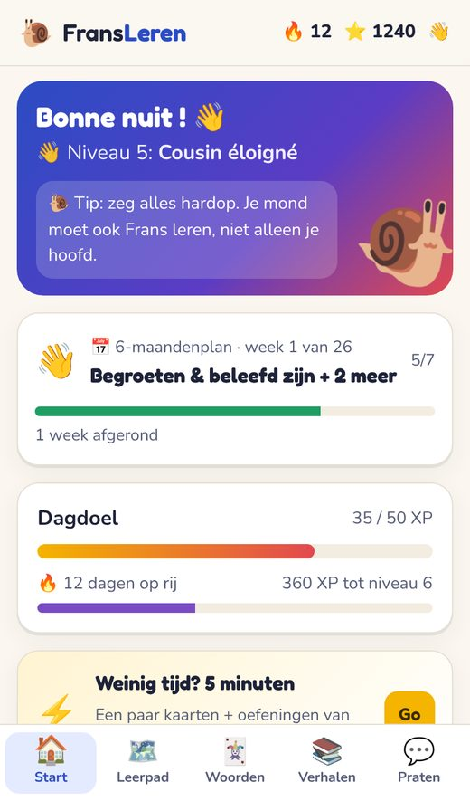 | 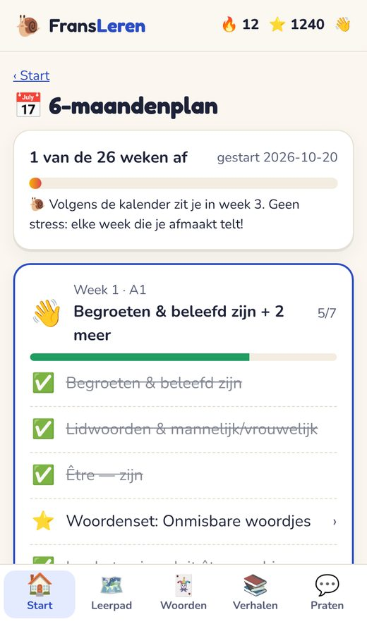 | 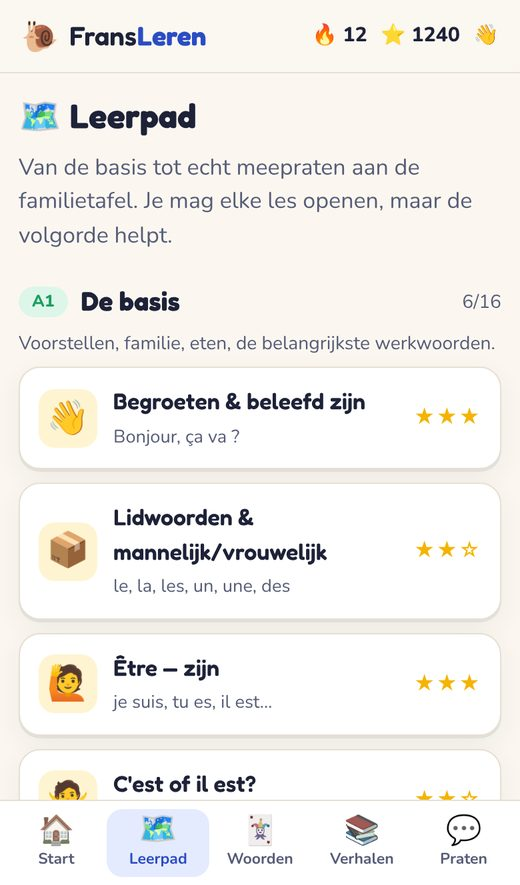 | 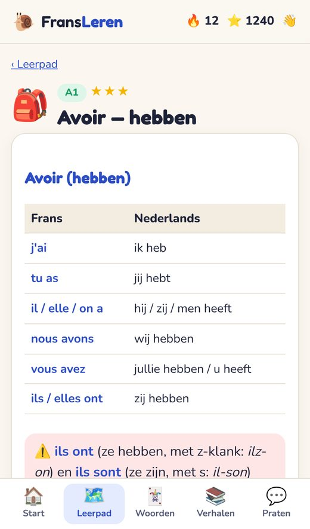 |

| Oefening | Verhalen | Verhaal | Tik = vertaling |
|---|---|---|---|
| 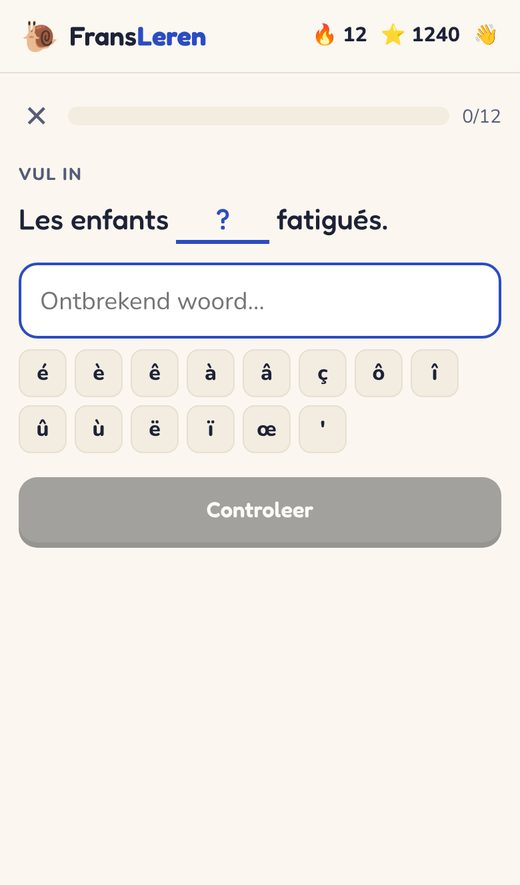 | 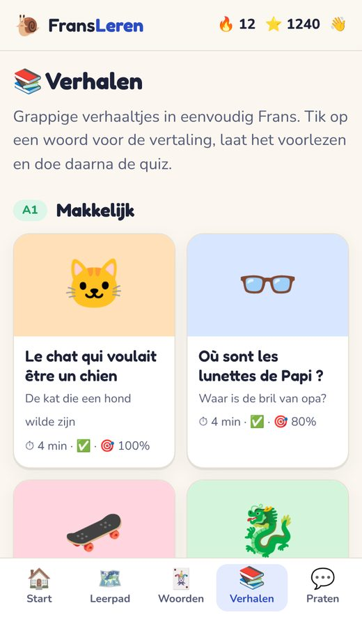 | 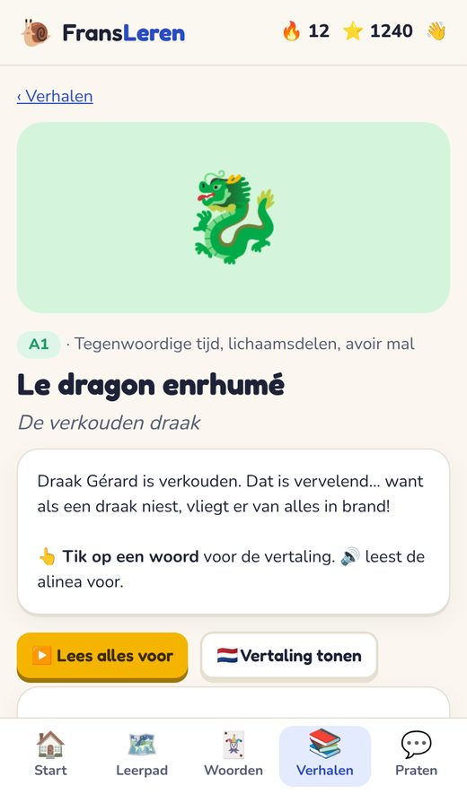 | 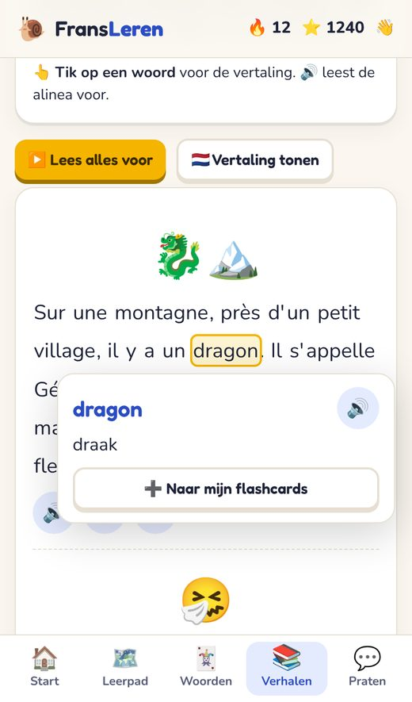 |

| Woorden | Gesprek | Profiel |
|---|---|---|
| 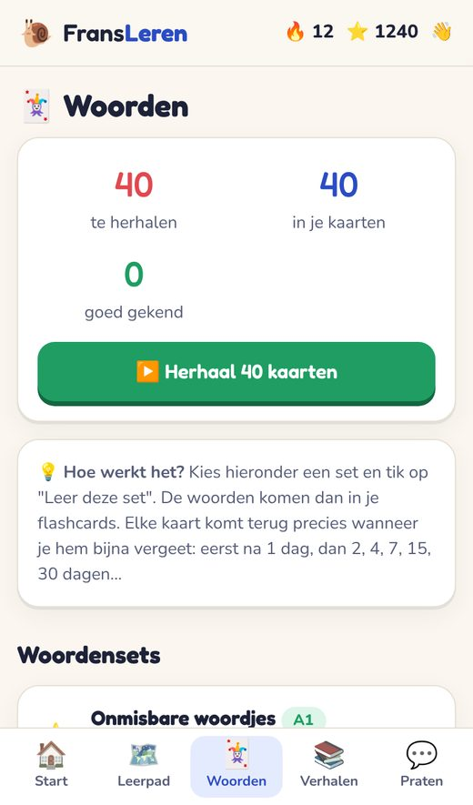 | 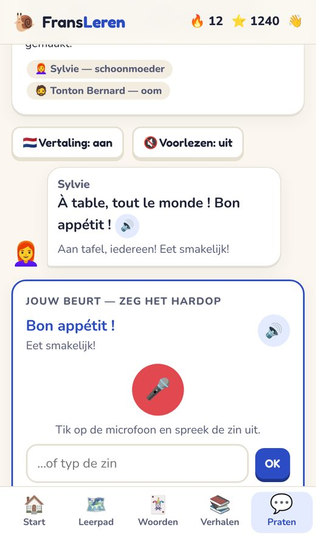 | 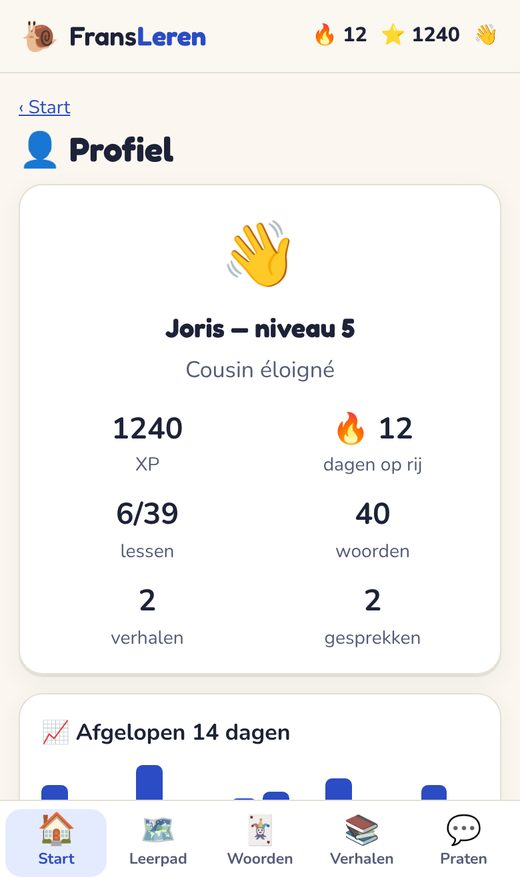 |

## 3. Zo gebruik je het (aanrader)

1. **Installeer** op je iPhone: open de link in Safari → deelknop (□↑) → *Zet op beginscherm*.
2. **Start je 6-maandenplan** (kaart bovenaan de startpagina).
3. **2–4 keer per week 10–15 minuten**: werk de taken van je week af. Ze vinken zichzelf af.
4. **Drukke dag?** Tik op ⚡ *5 minuten*. Liever 5 minuten dan niets.
5. **Voor een familiebezoek:** oefen de gesprekken, het zinnenboek, de spreektrainer en *Mijn familie*.

Tip: zet geluid aan (stille modus uit) — alle Franse zinnen worden voorgelezen.

## 4. Delen met anderen

- **Gewoon de link sturen.** Iedereen kan de app gratis gebruiken en installeren.
- Ieder apparaat heeft zijn **eigen voortgang** (opgeslagen in de browser). Niemand ziet die van een ander.
- Voortgang meenemen naar een ander apparaat: *Profiel → Back-up*.
- **Kosten: €0.** GitHub Pages is gratis voor dit soort sites, zonder limiet die je hiermee in de buurt komt.

## 5. Kan dit geld opleveren? (eerlijke analyse)

**Kort antwoord:** als hobbyproject: nauwelijks. Als serieus product: misschien een klein beetje, maar het kost dan wel tijd en geld. Tegen Duolingo concurreren is niet realistisch — maar een **niche** kan wel.

### Kosten als je het groter wilt maken

| Wat | Kosten | Nodig? |
|---|---|---|
| Hosting (GitHub Pages) | €0 | Nee, werkt al |
| Eigen domein (bv. fransleren.nl) | ±€10–15 per jaar | Optioneel, voor uitstraling |
| Apple App Store | $99 (±€92) per jaar | Alleen als je een "echte" iOS-app wilt |
| Google Play Store | $25 eenmalig | Alleen voor een Android-app |
| Moedertaalspreker die meeleest | ±€200–500 eenmalig | **Sterk aangeraden vóór je geld vraagt** |
| Echte stemopnames (i.p.v. computerstem) | €0–500+ | Optioneel |

### Mogelijke verdienmodellen

| Model | Realistisch? | Opmerking |
|---|---|---|
| Donatieknop (bv. "Buy me a coffee") | ✅ Makkelijk | Opbrengst meestal enkele euro's per maand |
| Eenmalige aankoop (€3–10) | 🟡 Mogelijk | Vereist een betaalmuur of app-store; mensen verwachten taal-apps gratis |
| Premium-content (extra verhalen, B2) | 🟡 Mogelijk | Meer werk; vergt account/betaalsysteem |
| Scholen / taalcursussen / inburgering in Frankrijk | 🟡 Interessant | Juist de niche "Nederlanders met Franse familie/tweede huis" is een gat in de markt |
| Advertenties | ❌ Afgeraden | Weinig opbrengst, slechte ervaring |

### Waarom niet "concurreren met Duolingo"?

Duolingo heeft honderden medewerkers, spelletjes-psychologie, echte stemmen en miljoenen gebruikers. **Wat FransLeren wél uniek heeft:** uitleg in het Nederlands, focus op *familie & schoonfamilie*, grappige eigen verhalen, en geen advertenties of abonnement. Daar kan een kleine, trouwe groep gebruikers op afkomen (bijvoorbeeld via Facebook-groepen van Nederlanders in Frankrijk).

### Belangrijke aandachtspunten

- **De inhoud is door AI geschreven** en automatisch getest, maar niet door een Franse moedertaalspreker nagelezen. Prima voor jezelf; laat het nalezen vóór je er geld voor vraagt.
- Privacy is nu simpel (alles blijft op het toestel). Met accounts of betalingen komt er AVG/GDPR-werk bij.
- **Er is niets betaalds aangezet.** Alles is en blijft gratis tot jij anders besluit.

## 6. Hoe het technisch in elkaar zit (kort)

- Een "statische" website: alleen HTML, CSS en JavaScript, geen server en geen database.
- Gehost op **GitHub Pages**; elke wijziging in de `main`-branch staat ±1 minuut later live.
- Voortgang staat in de browser (`localStorage`).
- Spraak (voorlezen + herkennen) gebruikt de ingebouwde spraak van je telefoon.
- Werkt offline dankzij een *service worker*.
- Inhoud staat in `js/data/` (lessen, verhalen, gesprekken, woorden…); schermen in `js/views/`.
- Testscripts in `tests/` (zie [`tests/README.md`](../tests/README.md)): alle schermen op iPhone 13/SE/Pixel 7, alle ±540 oefeningen, alle gesprekken, en een complete "leerdag".

## 7. Uitbreidingen die klaarliggen

Zie [`PLANS.md`](../PLANS.md): opties die al gebouwd en getest zijn, maar nog niet aan staan. Eén zin aan Claude is genoeg om er een te activeren.
